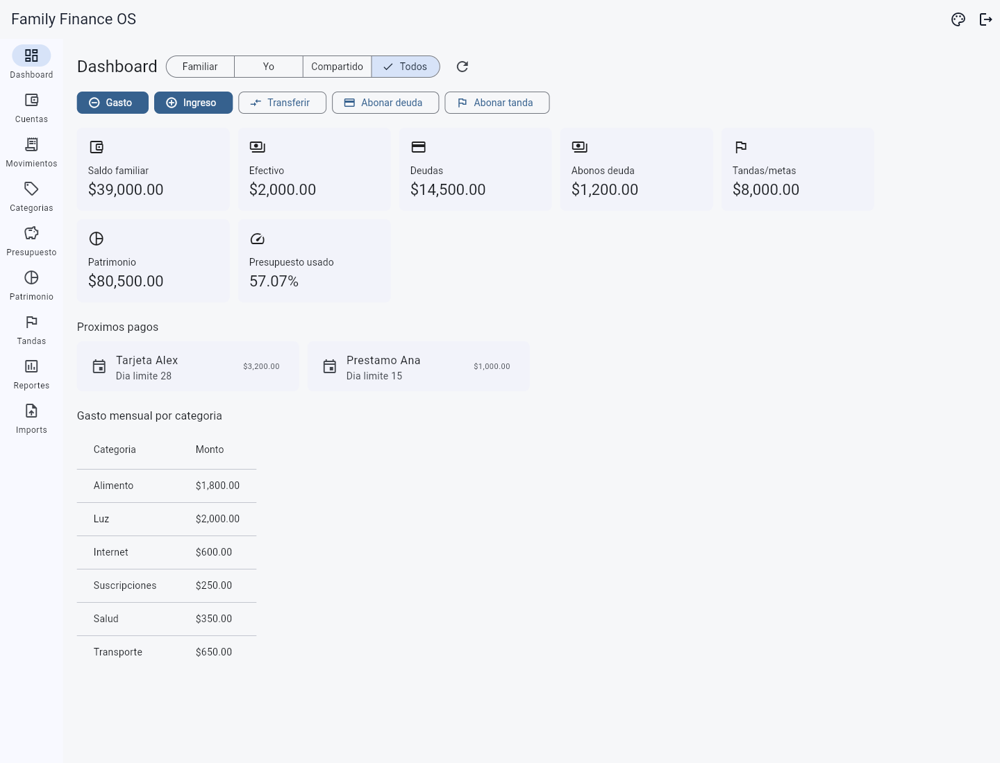

# César K. Padilla Hernandez · Desarrollador full stack

**CKPH07 · Software, producto y operación.**

Desarrollo aplicaciones que conectan procesos operativos con datos trazables.
Trabajo con Python/FastAPI, Flutter y React, con foco en reglas de negocio,
persistencia y diseño de producto. Este portfolio presenta mi participación,
las decisiones técnicas y la evidencia disponible de cuatro proyectos.

[Ver proyectos](#proyectos) · [Enfoque](#enfoque) · [Contacto](#contacto)

## Proyectos

### Desert Brew OS

**MES + ERP modular para la operación de una cervecería artesanal.**

Conecta compras, inventario, producción, ventas B2B y finanzas, conservando
el origen de los insumos y el costo histórico de cada venta.

**Mi aportación:** desarrollador principal; arquitectura por dominio,
backend e interfaz Flutter, con foco en trazabilidad y reglas operativas.

**Tecnologías:** Flutter · Dart · Python · FastAPI · PostgreSQL · RabbitMQ · Docker

**[Explorar el proyecto →](projects/desert-brew-os/README.md)**

### Desert Brew Co. — Plataforma web

**Catálogo, descubrimiento de productos y administración de contenido para una cervecería artesanal.**

Ayuda a descubrir cervezas y puntos de venta, y permite al equipo mantener
la disponibilidad y preparar lanzamientos desde una administración autorizada.

**Mi aportación:** desarrollador principal; implementación full stack del
catálogo, localizador y administración, con persistencia y control de revisiones.

**Tecnologías:** React · TypeScript · vinext/Vite · Tailwind · Leaflet · Cloudflare Workers · D1 · R2

**[Explorar el proyecto →](projects/dbc-web/README.md)**

### El día de Tadeo

**Arquitectura, implementación técnica y despliegue de una aplicación web interactiva.**

Conecta una experiencia educativa con persistencia de sesiones y un panel
docente protegido.

**Mi aportación:** arquitectura, implementación técnica y despliegue en
Render. El contenido, las ilustraciones y la propuesta pedagógica corresponden
al equipo del proyecto.

**Tecnologías:** JavaScript · Python · FastAPI · PostgreSQL · SQLAlchemy · Alembic · Render

**[Explorar el proyecto →](projects/el-dia-de-tadeo/README.md)**

### Family Finance OS

**Control de cuentas, deudas, ahorro y presupuesto para una familia.**

Organiza cuentas, deudas, ahorro y patrimonio. Distingue los movimientos
internos del gasto real y permite planear servicios mensuales o bimestrales.

**Mi aportación:** desarrollador principal; arquitectura e implementación
del MVP, reglas financieras e interfaz Flutter.

**Tecnologías:** Flutter · Dart · Python · FastAPI · PostgreSQL · Redis · Docker

**Estado:** MVP local en evolución. Interfaz mostrada con datos ficticios;
sin conexión bancaria automática.

**[Explorar el proyecto →](projects/family-finance-os/README.md)**

## Enfoque

- **Procesos claros:** organizar el producto alrededor del trabajo que necesita realizar el usuario.
- **Trazabilidad:** conservar el origen de los datos y las decisiones que los transforman.
- **Arquitectura por dominio:** definir responsabilidades explícitas y contratos de integración.
- **Evidencia:** distinguir capacidades implementadas, demostraciones y trabajo futuro.

## Contacto

Me interesa conversar sobre oportunidades de desarrollo full stack en las que
pueda aportar al producto, las reglas de negocio y la implementación técnica.

- **Correo:** [c.padilla13.cph@gmail.com](mailto:c.padilla13.cph@gmail.com)
- **LinkedIn:** [linkedin.com/in/ckph3372](https://www.linkedin.com/in/ckph3372)
- **GitHub:** [github.com/Ckph07](https://github.com/Ckph07)

## Acerca de este portafolio

Las fichas son presentaciones públicas de los proyectos. Cada una identifica
su alcance y el contexto de sus capturas. El acceso a este portafolio no
otorga acceso a los sistemas operativos ni a sus repositorios de código.

Para incorporar otro proyecto, consulta la
[guía para agregar proyectos](CONTRIBUTING.md) y utiliza la
[plantilla de ficha](templates/project.md).
