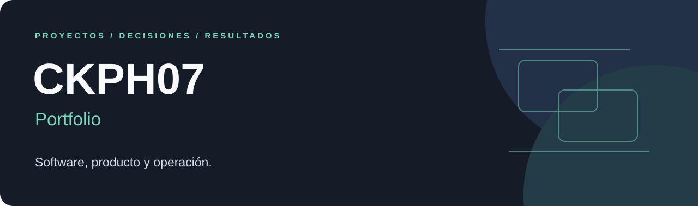

# CKPH07 · Portfolio

**Proyectos de software, producto y operación.**

Este portafolio reúne proyectos con problemas concretos, decisiones de diseño
y arquitectura, y ejemplos de sus interfaces. Cada ficha explica qué se
construyó, para qué sirve y qué aspectos técnicos lo distinguen.

[Ver proyectos](#proyectos) · [Enfoque](#enfoque) · [Perfil de GitHub](https://github.com/Ckph07)

## Proyectos

### Desert Brew OS

**MES + ERP modular para la operación de una cervecería artesanal.**

Conecta compras, inventario, producción, ventas B2B, finanzas y análisis de
rentabilidad. El diseño conserva la trazabilidad desde los insumos hasta el
costo histórico de una venta.

**Tecnologías:** Flutter · Dart · Python · FastAPI · PostgreSQL · RabbitMQ · Docker

**Aspectos destacados:** inventario FIFO, máquinas de estados de producción,
eventos durables, precios con aprobación y evaluación sensorial versionada.

**[Explorar el proyecto →](projects/desert-brew-os/README.md)**

## Enfoque

- **Procesos claros:** organizar el producto alrededor del trabajo que necesita realizar el usuario.
- **Trazabilidad:** conservar el origen de los datos y las decisiones que los transforman.
- **Arquitectura por dominio:** definir responsabilidades explícitas y contratos de integración.
- **Evidencia:** distinguir capacidades implementadas, demostraciones y trabajo futuro.

## Acerca de este portafolio

Las fichas son presentaciones públicas de los proyectos. Cada una identifica
su alcance y el contexto de sus capturas. El acceso a este portafolio no
otorga acceso a los sistemas operativos ni a sus repositorios de código.

Para incorporar otro proyecto, consulta la
[guía para agregar proyectos](CONTRIBUTING.md) y utiliza la
[plantilla de ficha](templates/project.md).

**Perfil:** [github.com/Ckph07](https://github.com/Ckph07)
