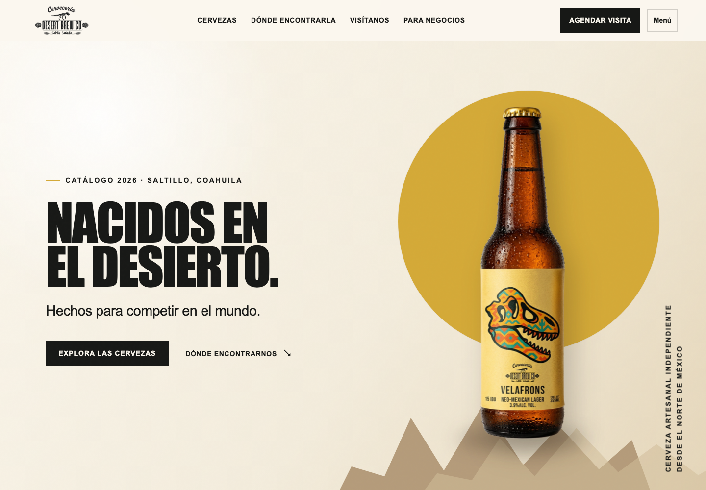
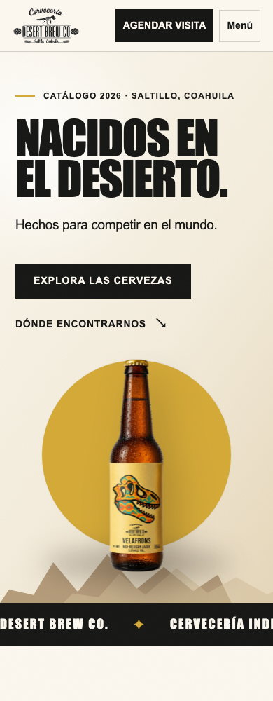
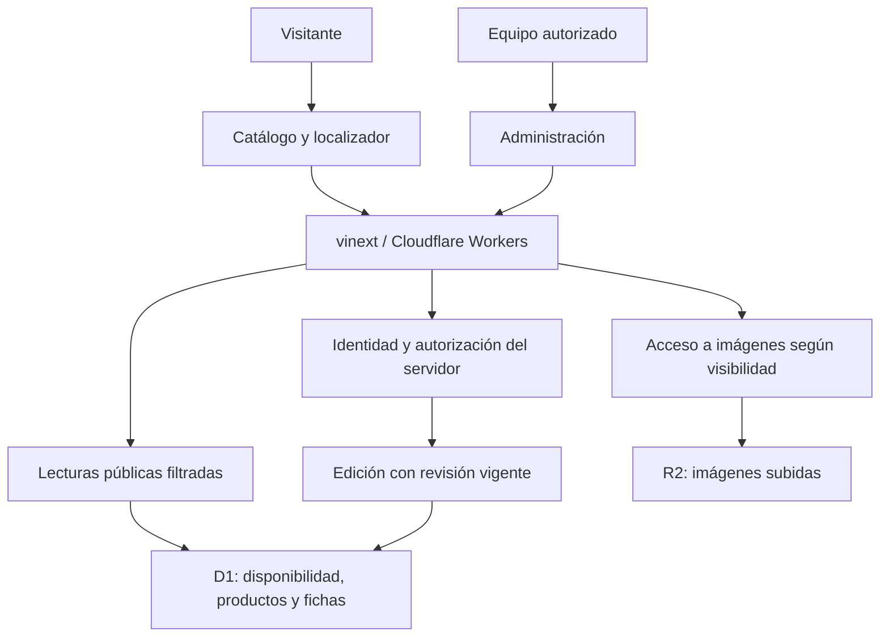

# Desert Brew Co. — Plataforma web

**Catálogo, descubrimiento de productos y administración de contenido para una cervecería artesanal.**

DBC Web conecta el catálogo y los puntos de venta de Desert Brew Co. con una
administración autorizada de disponibilidad y lanzamientos de Desert Lab.

- **Rol:** desarrollador principal de la implementación full stack.
- **Reto principal:** mantener información comercial vigente y permitir edición concurrente sin publicar borradores privados.
- **Estado:** catálogo, localizador y administración implementados en el código revisado.
- **Evidencia:** revisión local al **4 de octubre de 2026**, casos técnicos y capturas anteriores de la portada en escritorio y móvil. Alcance en [Calidad y evidencia](#calidad-y-evidencia).

[Mi aportación](#mi-aportación) · [Producto](#el-producto) · [Interfaz](#interfaz) ·
[Arquitectura](#arquitectura-y-tecnologías) · [Casos técnicos](#casos-técnicos) ·
[Calidad](#calidad-y-evidencia) · [Volver al portafolio](../../README.md)

## Mi aportación

Como desarrollador principal, trabajé en la implementación full stack de la
experiencia pública y de las herramientas de administración.

- **Frontend:** catálogo, localizador e interfaces de administración con React y TypeScript, adaptadas a escritorio y móvil.
- **Servidor y persistencia:** rutas de lectura y escritura, registros en D1 y almacenamiento de imágenes en R2.
- **Reglas de edición:** vigencia de disponibilidad, autorización, control de revisiones y separación entre borradores y contenido público.

## El problema

Un catálogo de cerveza necesita ayudar al visitante a elegir un producto,
conocer su presentación y encontrar dónde comprarlo. La disponibilidad cambia
con el tiempo y la información comercial puede dejar de representar el
surtido de un establecimiento.

El equipo también necesita preparar novedades antes de publicarlas,
administrar imágenes y actualizar fichas sin que dos editores sobrescriban
sus cambios. El reto consiste en conectar la presentación de marca con
información vigente y una administración controlada.

## El producto

| Capacidad | Comportamiento implementado | Propósito |
|---|---|---|
| **Catálogo** | Presentación de cervezas, fichas y visibilidad de productos activos | Facilitar el descubrimiento y la elección |
| **Localizador** | Búsqueda, mapa, puntos de venta y filtros por producto y presentación | Ayudar a encontrar el producto |
| **Disponibilidad** | Estados Disponible, Agotado y Por confirmar, con fecha de confirmación | Mostrar información con vigencia explícita |
| **Administración** | Edición autorizada de surtido, productos y fichas | Permitir que el equipo mantenga el contenido |
| **Desert Lab** | Borrador, Próximamente, Lanzada y Archivada, con imágenes asociadas | Preparar y comunicar novedades |
| **Visitas y contacto** | Formulario que prepara una solicitud para WhatsApp | Facilitar el contacto sin afirmar una reserva confirmada |

Activar un producto, publicar una ficha y confirmar su disponibilidad son
acciones independientes. Un lanzamiento comercial no genera por sí solo una
confirmación de stock; reactivar un producto requiere una confirmación de
disponibilidad posterior a su reactivación.

## Interfaz

La experiencia utiliza tipografía de alto contraste, superficies claras,
acentos dorados y fotografías de producto. La portada organiza la navegación
alrededor de cervezas, puntos de venta, visitas e información para negocios.

Las imágenes provienen de una revisión anterior y muestran únicamente la
portada pública en escritorio y móvil.

### Escritorio

La composición distribuye el mensaje y las acciones a la izquierda, con el
producto como protagonista visual a la derecha. La captura corresponde a un
viewport de 1440 píxeles de ancho.

### Móvil

La vista móvil adapta navegación, contenido y producto a una columna,
manteniendo visibles las acciones de explorar cervezas y localizar puntos
de venta. La captura corresponde a un viewport de 390 píxeles de ancho.

## Arquitectura y tecnologías

La aplicación combina componentes React y rutas de servidor ejecutadas
mediante vinext sobre Cloudflare Workers. Los registros administrables
persisten en D1; las imágenes subidas se almacenan en R2 y sus referencias
se conservan en D1.

| Tecnología | Uso en el proyecto |
|---|---|
| **React y TypeScript** | Componentes de interfaz, estados y contratos de datos |
| **vinext y Vite** | Ejecución y compilación de la aplicación con rutas de servidor |
| **Tailwind CSS** | Estilos y adaptación visual |
| **Leaflet** | Mapa y navegación geográfica |
| **Cloudflare Workers** | Ejecución del servidor y acceso a los recursos vinculados |
| **D1** | Persistencia de disponibilidad, estados de producto, fichas y revisiones |
| **R2** | Almacenamiento de imágenes subidas |
| **Drizzle y migraciones SQL** | Definición y evolución del esquema |
| **Node Test Runner** | Pruebas de reglas, APIs y HTML renderizado |

La identidad del equipo proviene del inicio de sesión de la plataforma Sites.
El servidor comprueba la lista de cuentas autorizadas en cada operación
administrativa; iniciar sesión no basta para obtener permisos de edición.

## Casos técnicos

### 1. La disponibilidad tiene una vigencia definida

**Problema:** una confirmación antigua puede hacer creer al visitante que
todavía hay producto disponible.

**Implementación:** los estados Disponible y Agotado conservan su vigencia
durante **15 × 24 horas** desde la confirmación. Al alcanzar ese límite, el
estado efectivo pasa a Por confirmar. Una fecha inválida, futura o ausente
no acredita disponibilidad. Una reconfirmación renueva el plazo.

**Comportamiento:** el mapa y los filtros de disponibilidad utilizan
confirmaciones vigentes. Sin filtros de producto, los puntos de venta siguen
accesibles aunque no tengan surtido confirmado. La ausencia de un registro
no se interpreta como Agotado.

### 2. Dos editores no sobrescriben silenciosamente sus cambios

**Problema:** dos personas pueden abrir la misma ficha y guardar desde una
versión que dejó de ser vigente.

**Implementación:** cada registro tiene una revisión. La escritura compara
la revisión enviada con la persistida y la incrementa al guardar. En
disponibilidad, esa comprobación ocurre en una única sentencia SQL; las
altas concurrentes también tienen protección contra duplicados.

**Comportamiento:** una escritura basada en una revisión desactualizada
devuelve un conflicto `409`. El panel comunica que se debe revisar la última
versión y conserva el borrador del editor. Las operaciones administrativas
comprueban autorización y origen antes de escribir.

### 3. Preparar contenido no lo hace público

**Problema:** el equipo necesita trabajar con fichas e imágenes antes de
anunciar un lanzamiento, sin enviarlas al visitante.

**Implementación:** la lectura pública de Desert Lab excluye borradores y
productos inactivos, y elimina los metadatos del editor y de revisión. El
servidor controla también el acceso a las imágenes: para un visitante, una
imagen debe estar asociada a una ficha visible y activa.

**Comportamiento:** subir una imagen no la hace pública. Las imágenes
reemplazadas permanecen almacenadas y, cuando dejan de estar vinculadas a
una ficha pública, requieren autorización. La carga admite PNG, JPEG y WebP
hasta 5 MB, validando tanto el tipo declarado como la firma del archivo.

## Calidad y evidencia

Ficha preparada mediante revisión del código y la documentación local al
**4 de octubre de 2026**. Las capturas conservadas no acreditan el estado actual
del despliegue, del catálogo o de la disponibilidad. No se verificó el servicio
público ni se volvió a ejecutar la suite durante su preparación.

La implementación incluye pruebas que cubren:

- Vencimiento en el límite de los 15 días y confirmaciones inválidas o futuras.
- Autorización, validación, persistencia y conflictos de edición concurrente.
- Importación idempotente de fichas, borradores e imágenes privadas.
- Activación y reactivación de productos con nueva confirmación de surtido.
- Búsqueda, fechas de visitas y preparación del mensaje de contacto.
- HTML renderizado, productos inactivos y estados de catálogo vacío o no disponible.

Las pruebas de API usan SQLite y sustituyen el módulo de ejecución de
Cloudflare dentro de Node. Esa verificación no equivale a una prueba del
despliegue real en Workers.

No se presentan aumentos de ventas, conversiones o rendimiento sin mediciones.

## Estado y próximos pasos

| Estado | Alcance |
|---|---|
| **Implementado en el código revisado** | Catálogo, localizador, disponibilidad, administración de productos y Desert Lab |
| **Evidencia visual anterior** | Portada pública en escritorio y móvil |
| **Pendiente de verificación actual** | Despliegue, resultados de ejecución de pruebas y métricas de uso |
| **Evolución posible** | Medir búsquedas, consultas de puntos de venta, solicitudes de visita y frecuencia de actualización |

DBC Web se presenta como un proyecto independiente de Desert Brew OS.
Esta ficha no afirma sincronización de inventario ni integración operativa
entre ambos sistemas.

[Volver a CKPH07 Portfolio](../../README.md)
