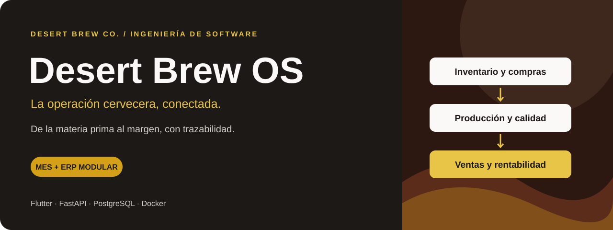
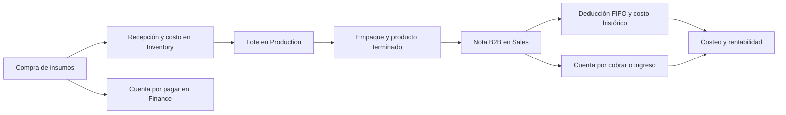
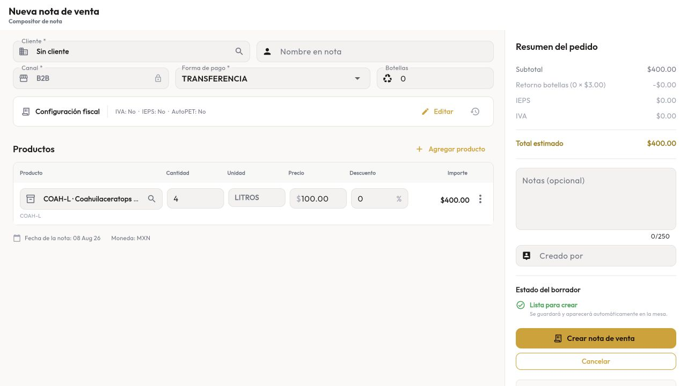
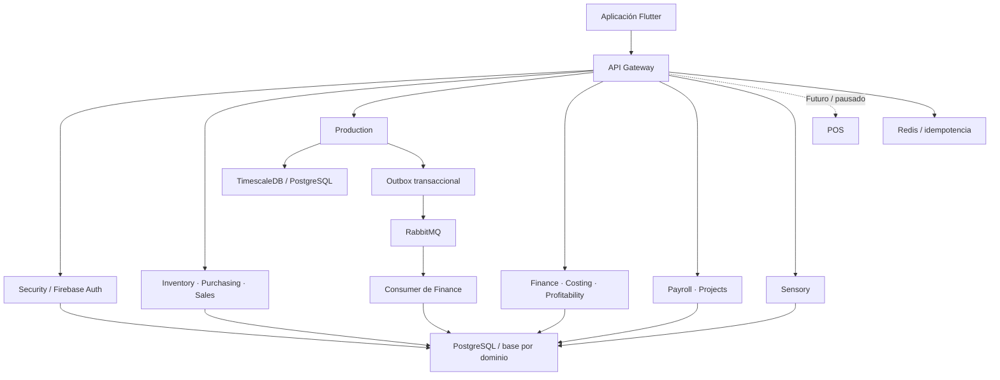

# Desert Brew OS

**Sistema modular de gestión y ejecución de producción para una cervecería artesanal.**

Combina un **MES** —ejecución de producción— con un **ERP** —gestión de recursos
y operaciones— para conectar compras, inventario, producción, ventas y finanzas
de Desert Brew Co.

- **Rol:** desarrollador principal, con trabajo en arquitectura, backend e interfaz Flutter.
- **Reto principal:** conservar el origen, los movimientos y los costos de una operación a través de varios dominios.
- **Estado:** capacidades implementadas en el repositorio; POS/Taproom pausado o futuro.
- **Evidencia:** revisión de código y documentación al **4 de octubre de 2026**, casos técnicos y una captura de ventas con datos de demostración. Alcance en [Calidad y evidencia](#calidad-y-evidencia).

[Mi aportación](#mi-aportación) · [Producto](#el-producto) · [Interfaz](#interfaz-del-producto) ·
[Arquitectura](#arquitectura) · [Casos técnicos](#casos-técnicos) ·
[Calidad](#calidad-y-evidencia) · [Volver al portafolio](../../README.md)

## Mi aportación

Mi trabajo como desarrollador principal abarcó la arquitectura por dominio y
la implementación del backend y de la aplicación Flutter.

- **Arquitectura:** responsabilidades y contratos entre servicios para seguir compras, inventario, producción, ventas y costos.
- **Backend:** reglas operativas de trazabilidad, consumo FIFO, ciclos de producción y operaciones que admiten reintentos.
- **Frontend:** interfaz Flutter organizada por funcionalidades para trabajar con los módulos y sus APIs.

## El problema

La operación de una cervecería une procesos con unidades y reglas diferentes:
materias primas por peso o volumen, recetas por lote, barriles individuales,
producto envasado por unidad, precios por presentación y obligaciones
financieras por documento.

Cuando esas piezas se administran por separado, resulta difícil responder
preguntas prácticas: ¿qué lote se consumió?, ¿cuánto costó realmente producir
un litro vendible?, ¿qué barril sigue con un cliente?, ¿qué costo corresponde
a una venta histórica? y ¿existe evidencia suficiente para calcular el margen?

## El producto

La plataforma organiza el trabajo en módulos especializados, accesibles desde
una aplicación Flutter. Cada servicio conserva sus reglas y sus datos; las
integraciones permiten seguir una operación a través de varias áreas.

| Área | Capacidad implementada | Valor para la operación |
|---|---|---|
| **Compras** | Órdenes, costo aterrizado, recepción parcial y mapeo de SKU de proveedor | Vincular el abastecimiento con stock y cuentas por pagar |
| **Inventario** | FIFO, insumos, producto terminado, ubicaciones y barriles serializados | Conocer existencias, origen, costo y activos retornables |
| **Producción** | Recetas, lotes, cocción o mezcla, fermentación, maduración y empaque | Documentar el proceso y sus litros vendibles reales |
| **Ventas B2B** | Clientes, establecimientos, catálogo, notas y controles de crédito y barriles | Conectar la venta con inventario y obligaciones de cobro |
| **Finanzas** | Ingresos, egresos, tesorería, CxC/CxP, costos fijos y transferencias internas | Dar seguimiento al dinero y separar centros de utilidad |
| **Costeo y precios** | Absorción, snapshots, simulaciones y recomendaciones con aprobación | Fundamentar precios con costos trazables |
| **Rentabilidad** | Contribución, márgenes, punto de equilibrio y snapshots mensuales | Analizar resultados con cobertura de datos explícita |
| **Sensorial** | Catas por lote y etapa, perfiles objetivo versionados y rueda aromática | Conservar observaciones y comparar la evolución del producto |
| **Nómina** | Empleados, entradas de nómina, pagos y propinas | Organizar obligaciones del equipo |
| **Proyectos** | Kanban, resultados, KPIs, actividades y calendario | Coordinar iniciativas y dar seguimiento a objetivos |
| **Seguridad** | Firebase Auth, roles y registro de dispositivos | Controlar identidad y acceso a operaciones |

El sistema contiene **12 servicios de dominio**, además del API Gateway.
**POS/Taproom permanece como trabajo futuro/pausado** y no se presenta aquí
como una función operativa aprobada.

### Una operación de principio a fin



El flujo conecta documentos, movimientos y costos. Su consistencia depende de
contratos entre servicios, operaciones idempotentes y mecanismos de
conciliación explícitos.

## Interfaz del producto

La interfaz utiliza superficies claras, acentos dorados y navegación por
área. La portada utiliza los colores del tema implementado de la aplicación.

### Captura de una nota de venta



La composición presenta productos y resumen de importes al mismo tiempo,
para que el operador conserve el contexto de la venta durante la captura.
Esta imagen corresponde a una **preview aislada con datos deterministas** de
una auditoría de interfaz realizada el 8 de agosto de 2026.
Los importes mostrados son datos de demostración.

## Arquitectura

El proyecto utiliza un monorepo con backend por microservicios y una aplicación
Flutter organizada por funcionalidades. La decisión central es una **base de
datos por dominio**: cada servicio posee sus entidades y expone contratos para
que las demás áreas interactúen con ellas.



El diagrama resume componentes y persistencia. Los servicios se comunican
mediante contratos HTTP y eventos explícitos.

| Capa | Tecnologías del repositorio | Responsabilidad |
|---|---|---|
| Aplicación | Flutter, Dart, BLoC, GoRouter, Dio | Presentación, estado, navegación y acceso a APIs |
| Backend | Python, FastAPI, SQLAlchemy, Pydantic | Contratos HTTP, validación y lógica de dominio |
| Persistencia | PostgreSQL, TimescaleDB/PostgreSQL, Alembic | Datos por dominio, transacciones y migraciones |
| Integración | HTTP, RabbitMQ, Redis | Contratos entre servicios, eventos e idempotencia |
| Identidad | Firebase Auth, RBAC, Ed25519 | Autenticación, roles y verificación de dispositivos |
| Entorno local | Docker Compose y launcher | Ejecución de servicios e infraestructura |
| Verificación | pytest y Flutter Test | Pruebas de lógica, contratos, integración y widgets |

La estructura de Flutter separa `data`, `domain` y `presentation` por feature.
En el backend, cada servicio organiza APIs, modelos, esquemas, lógica, clientes
y pruebas. Esta separación facilita revisar reglas e integraciones por área.

## Casos técnicos

### 1. Una venta conserva su costo histórico

**Problema:** el inventario restante cambia después de una venta. Usarlo para
reconstruir el costo de una nota histórica puede producir un margen incorrecto.

**Implementación:** Sales solicita una deducción de la nota completa a
Inventory. Inventory valida las líneas, bloquea los candidatos FIFO y aplica
los movimientos en una transacción. La operación conserva lote, cantidad y
costo, junto con una llave y una huella del payload para reconocer reintentos.

**Comportamiento:** un replay idéntico reutiliza el resultado; reutilizar la
misma llave con otro contenido produce un conflicto. Costing consume el
documento histórico y señala cobertura incompleta cuando falta evidencia.

### 2. Cada proceso de producción tiene su propio ciclo

**Problema:** una bebida preparada y una cerveza no recorren las mismas etapas.
Aplicarles una secuencia única permite estados que no representan el proceso.

**Implementación:** Production define transiciones independientes para
`BREWING` y `MIX_AND_PACKAGE`.

```text
Cerveza:  PLANNED → BREWING → FERMENTING → CONDITIONING → PACKAGING → COMPLETED
Mezcla:   PLANNED → MIXING → READY_FOR_PACKAGING → PACKAGING → COMPLETED
```

La cerveza también admite el paso directo de fermentación a empaque. Los
estados no terminales permiten cancelación controlada. El costo líquido final
utiliza litros vendibles reales, conservando el volumen planeado como referencia.

### 3. Los eventos de producción pueden reintentarse

**Problema:** guardar un cambio de lote y publicar un mensaje son operaciones
distintas. Una interrupción entre ambas puede dejar al resto del sistema sin
la notificación correspondiente.

**Implementación:** un outbox registra el evento en la misma transacción del
cambio de negocio. Un dispatcher publica los pendientes en RabbitMQ, conserva
intentos y programa reintentos. Finance consume los eventos con deduplicación.

**Comportamiento:** la intención de notificar permanece durable aunque la
publicación falle. El diseño contempla reentrega; no supone entrega única.

### 4. Calcular un precio, aprobarlo y publicarlo son acciones distintas

**Problema:** una simulación de costos no debería cambiar por sí sola el precio
que utiliza el equipo comercial.

**Implementación:** Costing genera recomendaciones `DRAFT`, conserva sus
snapshots y distingue aprobación de publicación. La publicación explícita
actualiza el catálogo de Sales, que sigue siendo dueño del precio comercial.
Las mutaciones de Costing exigen autorización administrativa en el backend.

**Comportamiento:** una recomendación puede revisarse antes de afectar el
catálogo; aprobarla todavía no publica el precio.

### 5. “No evaluado” y “ausente” son datos diferentes

**Problema:** convertir una observación sensorial faltante en cero confunde
ausencia de evaluación con ausencia observada de un atributo.

**Implementación:** Sensory conserva `null` para lo no evaluado y cero para
ausencia observada. Mantiene perfiles objetivo versionados e inmutables al
aprobarse, y cada evaluación conserva la referencia a su objetivo.

**Comportamiento:** cambiar un objetivo posteriormente no reescribe el
significado histórico de una cata. Los registros legados se identifican por
calidad y requieren revisión antes de incorporarse a nuevos agregados.

## Calidad y evidencia

Ficha preparada a partir del código y la documentación local al **4 de octubre
de 2026**. Describe capacidades implementadas; el despliegue y la disponibilidad
en producción no se verificaron durante su preparación.

La revisión local encontró **126 archivos de pruebas Python en `services/`**
y **89 archivos de pruebas Dart en `desert_brew_app/test/`**. Son conteos de
archivos presentes al preparar este portafolio, no de casos aprobados ni de
porcentaje de cobertura. Incluyen pruebas de POS y trabajo local en curso.

La implementación cuenta con pruebas de transacciones FIFO, transiciones de
estado, eventos, permisos y reglas de calidad de datos. La imagen de ventas
permite examinar la composición de la interfaz con datos de demostración.

Esta presentación se elaboró mediante revisión de código, configuración y
documentación. No se ejecutó la suite del sistema como parte de su preparación;
no se publican porcentajes de cobertura ni resultados de rendimiento.

## Estado y evolución

| Estado | Alcance |
|---|---|
| **Implementado en el repositorio** | Servicios y flujos descritos, aplicación Flutter, APIs, migraciones y pruebas |
| **Pausado / futuro** | POS/Taproom; su reactivación requiere resolver los contratos operativos definidos para el sistema |
| **Pendiente de validación para una presentación pública** | Estado del despliegue, resultados de una ejecución reciente de pruebas y mediciones de impacto |
| **Mejoras documentadas** | Controles transversales de integración y hallazgos de UX/accesibilidad |

El valor demostrado por el repositorio está en el diseño de dominio, la
trazabilidad y las reglas implementadas. Para una siguiente versión del
portafolio, conviene medir tiempos de captura, diferencias de inventario,
conciliaciones pendientes y cobertura de costos históricos sobre un periodo
definido. Esas métricas todavía no se presentan como resultados obtenidos.

[Volver a CKPH07 Portfolio](../../README.md)
