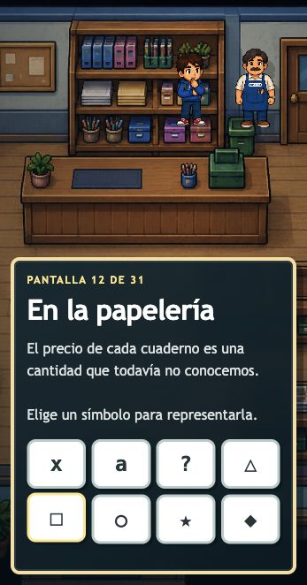
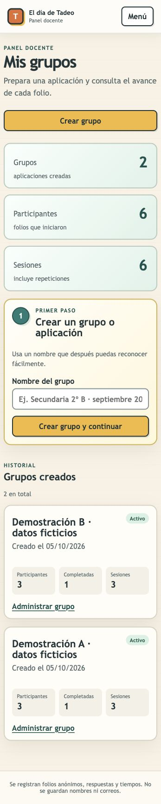
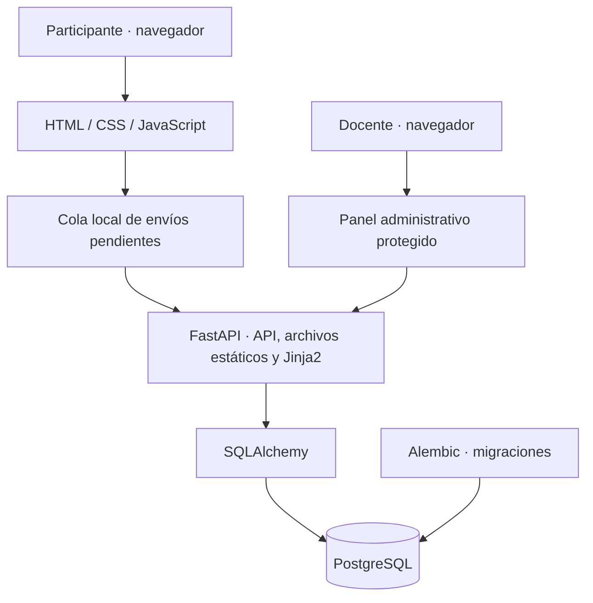

# El día de Tadeo

**Arquitectura, implementación técnica y despliegue de una aplicación web interactiva.**

Mi participación abarcó la arquitectura del sistema, la implementación
técnica y el despliegue. El contenido y la propuesta pedagógica fueron
definidos por el equipo del proyecto.

El sistema conecta una experiencia educativa en el navegador con una API de
persistencia y un panel docente protegido. Mi trabajo se centró en convertir
los requerimientos del proyecto en una aplicación operable: conservar el
avance, registrar respuestas y facilitar su consulta, con despliegue en Render.

[Interfaz](#interfaz) · [Arquitectura](#arquitectura-y-tecnologías) ·
[Decisiones técnicas](#decisiones-técnicas) · [Despliegue](#despliegue) ·
[Volver al portafolio](../../README.md)

## Mi aportación

| Área | Alcance de mi participación |
|---|---|
| **Arquitectura** | Organización del frontend, API, persistencia y panel administrativo; contratos para sesiones, respuestas y progreso |
| **Implementación** | Desarrollo técnico de la experiencia interactiva, integración con la API y herramientas de administración y consulta |
| **Despliegue** | Puesta en marcha en Render, configuración del servicio y la base de datos, variables de entorno y migraciones |

La narrativa, los materiales y los objetivos educativos corresponden al
equipo del proyecto. Esta ficha presenta mi contribución de ingeniería y
no atribuye resultados de aprendizaje a la implementación.

## El reto técnico

Una actividad de varias pantallas necesita conservar respuestas y avance
cuando el participante recarga la página o pierde brevemente la conexión.
Además, quien administra la aplicación debe poder consultar los registros
sin mezclar recorridos ni interpretar datos antiguos con reglas nuevas.

La solución utiliza folios anónimos para iniciar sesiones, guarda respuestas
e intentos de forma trazable y ofrece consulta y exportación desde el panel
protegido. El contenido educativo aporta el contexto de uso; el foco de este
caso es la infraestructura que lo hace funcionar.

## Interfaz

Capturas de la implementación local, tomadas el **4 de octubre de 2026** en
vista móvil. Se utilizó una instancia aislada con SQLite temporal: no se
consultaron registros de participantes reales. Estas imágenes no verifican
el estado actual del despliegue en Render.

### Inicio y actividad interactiva

| Inicio | Actividad |
|---|---|
|  |  |

El inicio presenta el acceso a la experiencia. La actividad muestra la
selección de un símbolo en el modo de revisión, que permite inspeccionar el
recorrido sin crear una sesión de participante. Las ilustraciones y el
contenido se muestran como contexto del sistema, sin atribuirme su autoría.

### Administración con datos ficticios

El panel permite crear grupos y consultar participación y sesiones. Todos
los nombres, conteos y estados de esta captura fueron preparados para la
demostración; no son métricas de uso ni resultados de una aplicación real.
Las fechas visibles pertenecen a los registros sintéticos del entorno local.

## Arquitectura y tecnologías

FastAPI sirve la experiencia HTML/CSS/JavaScript, expone la API y renderiza
el panel administrativo mediante Jinja2. SQLAlchemy conecta la aplicación
con PostgreSQL y Alembic mantiene la evolución del esquema.

| Tecnología | Responsabilidad |
|---|---|
| **HTML, CSS y JavaScript** | Pantallas interactivas, estado de interfaz y cola persistente en el navegador |
| **Python, FastAPI y Uvicorn** | API de sesiones y respuestas, servicio web y rutas administrativas |
| **Jinja2** | Renderizado del panel docente en el servidor |
| **PostgreSQL y SQLAlchemy** | Persistencia de grupos, folios, sesiones, respuestas y actividad |
| **Alembic** | Migraciones del esquema |
| **Argon2 e ItsDangerous** | Verificación de contraseña y firma de cookies y tokens CSRF administrativos |
| **Render** | Alojamiento del servicio Python y configuración de PostgreSQL |
| **Docker Compose** | PostgreSQL para desarrollo local |
| **pytest** | Pruebas de API, persistencia, administración y compatibilidad |

## Decisiones técnicas

### 1. Recuperar el avance después de una interrupción

**Problema:** una recarga o una interrupción breve de red puede separar lo que
el participante ve de lo que el servidor ha recibido.

**Implementación:** el navegador conserva una cola de envíos pendientes y el
servidor guarda una instantánea del progreso con número de revisión. La API
permite recuperar sesiones incompletas de la versión correspondiente y
rechaza actualizaciones de progreso que no sean más recientes.

**Resultado técnico:** el recorrido puede retomarse a partir del estado
persistido y los envíos pendientes pueden reintentarse. Esto no convierte
la aplicación en una experiencia completamente sin conexión.

### 2. Reintentar un envío sin duplicar el registro

**Problema:** reenviar una respuesta por un fallo de red no debe crear un
intento adicional, pero dos respuestas deliberadas deben conservarse aunque
su texto sea idéntico.

**Implementación:** los envíos incluyen un identificador de evento y el
servidor detecta duplicados dentro de cada sesión. La finalización espera la
sincronización de la cola y conserva un único cierre al repetir la solicitud.

**Resultado técnico:** la deduplicación depende de la identidad del evento,
no del contenido de la respuesta; los intentos distintos siguen siendo
consultables por separado.

### 3. Evolucionar la experiencia y conservar su historial

**Problema:** cambiar pantallas y catálogos puede alterar la interpretación
de respuestas recogidas con versiones anteriores.

**Implementación:** cada sesión conserva su `experience_version`; la API,
el panel y las exportaciones utilizan los catálogos correspondientes.

**Resultado técnico:** las sesiones históricas mantienen sus rangos y campos,
y pueden consultarse junto a las actuales sin reinterpretar sus respuestas.

### 4. Proteger la consulta administrativa

**Problema:** los registros de sesiones deben quedar disponibles para el
personal autorizado a través del panel.

**Implementación:** contraseña verificada con Argon2, cookie firmada con
caducidad, comprobación de acceso en las rutas protegidas y tokens CSRF en
formularios administrativos. Render configura la cookie con `Secure`; el
inicio de sesión también utiliza `HttpOnly` y `SameSite=Lax`.

**Resultado técnico:** la consulta y exportación administrativas requieren
una sesión autorizada. Esta descripción documenta controles implementados;
no representa una auditoría de seguridad.

## Despliegue

Realicé el despliegue en **Render**. La configuración versionada en
`render.yaml` define un servicio Python y una base PostgreSQL asociada.

- **Construcción:** instalación de las dependencias de Python.
- **Arranque:** aplicación de migraciones con `alembic upgrade head` y ejecución
  de Uvicorn en el puerto suministrado por Render.
- **Configuración:** conexión de base de datos, hash de contraseña administrativa,
  clave de firma, cookie segura y umbral de inactividad mediante variables
  de entorno, sin incluir valores de secretos en esta ficha.
- **Comprobación del servicio:** `/health` responde con el estado de la aplicación;
  este endpoint no comprueba por sí mismo la conectividad con PostgreSQL.
- **Entorno local:** Docker Compose proporciona PostgreSQL. La instancia usada
  para estas capturas empleó SQLite temporal con datos ficticios.

El despliegue se documenta como parte de mi participación. La revisión para
esta ficha se hizo sobre el código local y no verificó el servicio remoto
ni que sus cambios más recientes ya estén publicados.

## Calidad y evidencia

El repositorio incluye pruebas para recuperación de sesiones, revisiones de
progreso, idempotencia de respuestas y finalización, conservación de intentos,
compatibilidad histórica y protección del panel y las exportaciones CSV.
También contiene comprobaciones del flujo de pantallas y sus recursos.

Para preparar esta ficha se aplicaron las migraciones en una base temporal y
se revisaron visualmente el inicio, una actividad y el panel autenticado con
datos ficticios. **No se ejecutó la suite completa de pruebas en esta revisión.**

| Evidencia | Alcance |
|---|---|
| **Código local revisado** | Arquitectura, persistencia, controles de acceso y configuración de despliegue |
| **Capturas actuales** | Interfaz local en vista móvil y panel con datos de demostración |
| **Despliegue en Render** | Parte de mi trabajo, sin comprobación remota en esta revisión |
| **Cambios locales recientes** | La copia revisada incorpora análisis e informes; su presencia local no acredita publicación en Render |

No se presentan cifras de rendimiento, disponibilidad, adopción o impacto
educativo sin mediciones que las respalden.

[Volver a CKPH07 Portfolio](../../README.md)
