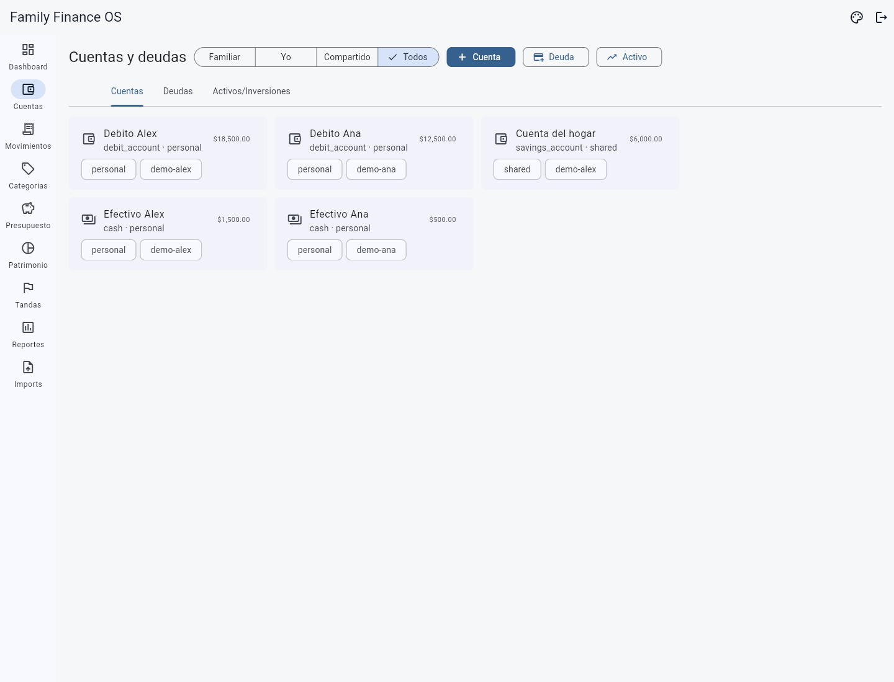
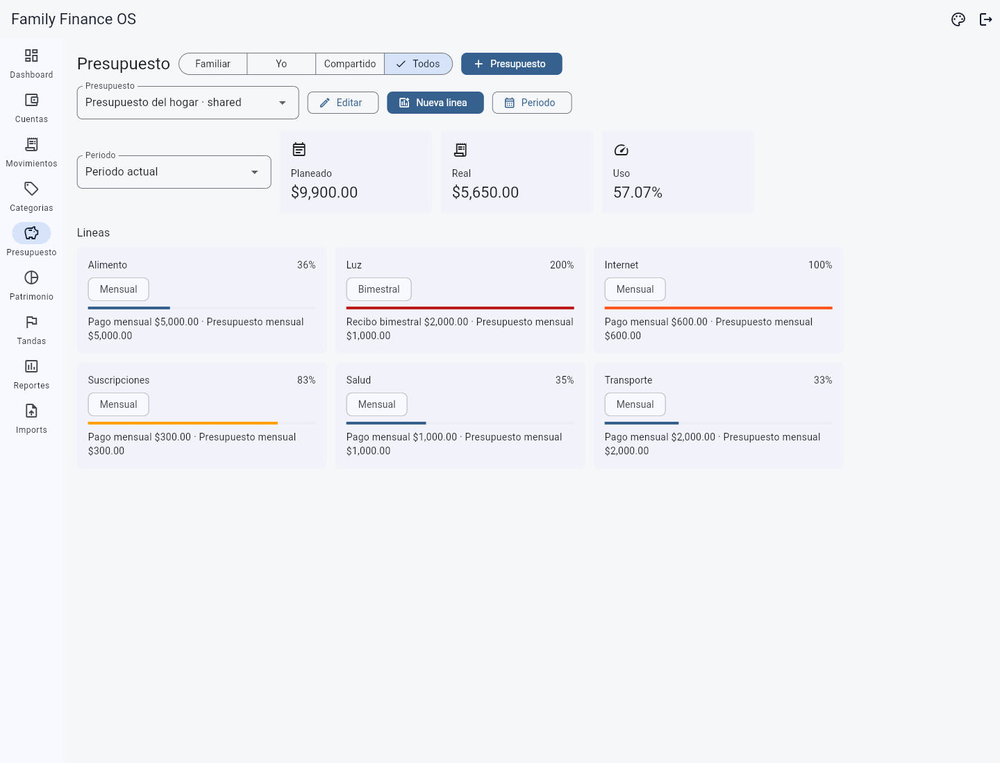
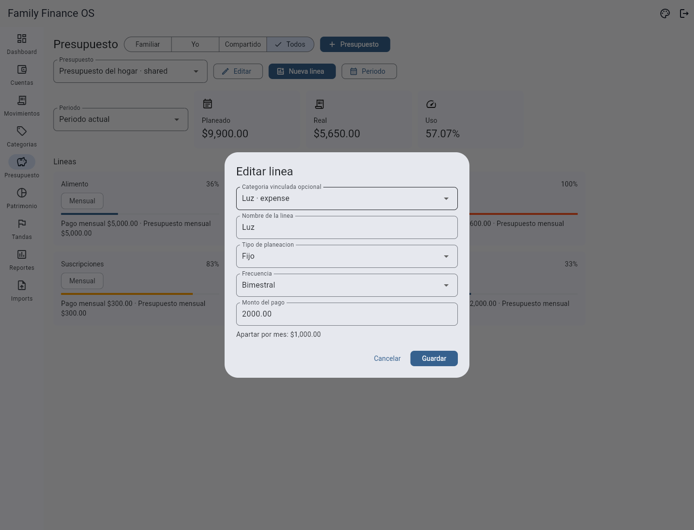
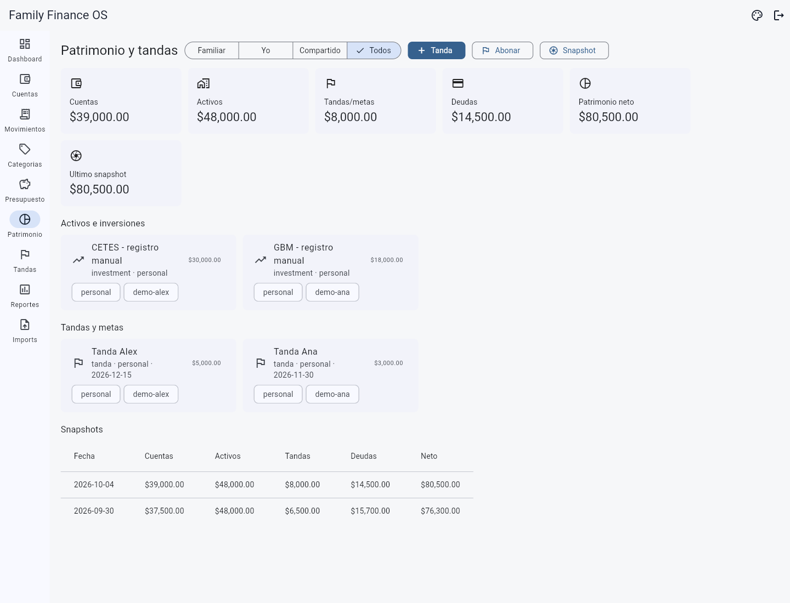
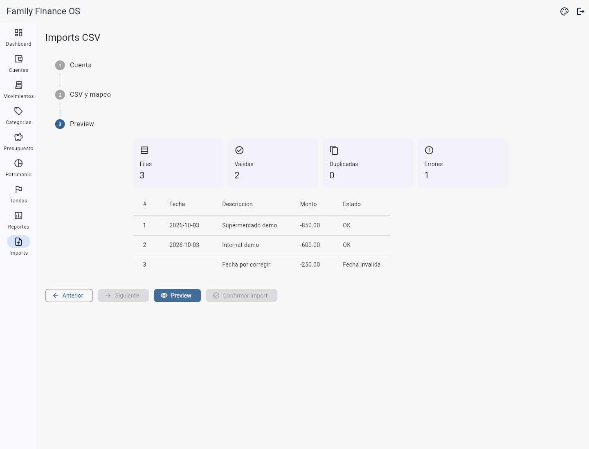
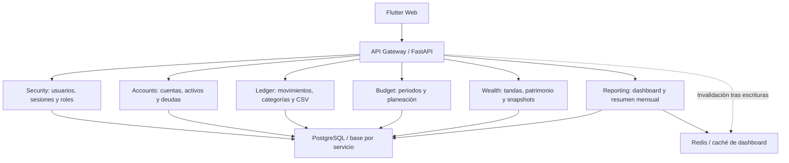

# Family Finance OS

**Aplicación de finanzas personales y familiares para organizar cuentas,
deudas, ahorro y presupuesto en un entorno local.**

Family Finance OS reúne la captura diaria de movimientos y el seguimiento
del patrimonio de una pareja. Separa dinero disponible, obligaciones y ahorro,
y contempla cuentas personales y compartidas sin conexión bancaria automática.

[Producto](#la-solución) · [Interfaz](#interfaz) ·
[Arquitectura](#arquitectura-y-tecnologías) · [Decisiones](#decisiones-técnicas) ·
[Calidad](#calidad-y-evidencia) · [Volver al portafolio](../../README.md)

> **Estado: MVP local en evolución.** Presentación basada en el código y la
> documentación local revisados el **4 de octubre de 2026**. Las capturas
> muestran la interfaz Flutter implementada con respuestas API ficticias en
> un navegador aislado; no son capturas de cuentas reales ni evidencia de
> disponibilidad en producción.

## El problema

Una pareja puede tener varias cuentas de débito, efectivo, tarjetas de crédito,
préstamos y metas de ahorro. A esas obligaciones se suman alimentos, mantenimiento
del hogar, ropa, servicios y suscripciones con distintas frecuencias de pago.

El reto es responder preguntas concretas: ¿cuánto dinero está disponible?,
¿cuánto debemos?, ¿qué parte ya está apartada para ahorrar? y ¿cuánto reservar
este mes para un recibo que llega cada dos meses?

Sumar todos los movimientos como ingresos o gastos produce una lectura
equivocada: transferir entre cuentas no genera ingreso nuevo y apartar dinero
en una tanda no equivale a consumirlo.

## La solución

El producto organiza la captura y la consulta por dominios financieros.

| Área | Capacidad implementada | Utilidad |
|---|---|---|
| **Cuentas y efectivo** | Alta y edición de cuentas con tipo, propietario, alcance y saldo | Identificar dónde está el dinero |
| **Movimientos y categorías** | Captura de ingresos y gastos con selectores; creación y edición de categorías | Clasificar la actividad sin introducir IDs manualmente |
| **Transferencias** | Salida y entrada vinculadas por un identificador común | Mover dinero sin inflar el gasto o el ingreso |
| **Deudas** | Tarjetas y préstamos con saldo simple; abonos desde una cuenta | Dar seguimiento a obligaciones y pagos |
| **Tandas y metas** | Bolsillos de ahorro con propietario, saldo, meta y aportaciones | Separar ahorro del gasto cotidiano |
| **Presupuesto** | Periodos mensuales, líneas por categoría, frecuencia mensual o bimestral y avance | Comparar gasto real con lo planeado |
| **Patrimonio** | Activos manuales, saldo neto y snapshots históricos | Consultar cuentas, inversiones, ahorro y deuda en conjunto |
| **Dashboard y reporte** | KPIs, próximos pagos registrados, gasto por categoría y resumen mensual | Revisar el estado financiero y abrir acciones de captura |
| **Importación CSV** | Pegado de contenido, mapeo de columnas, vista previa y confirmación | Revisar filas, errores y duplicados antes de importar |

### Un recorrido cotidiano

1. Registrar las cuentas personales, el efectivo y la cuenta compartida del hogar.
2. Crear categorías y definir un presupuesto mensual con servicios y suscripciones.
3. Capturar ingresos y gastos, o revisar un CSV antes de importarlo.
4. Transferir dinero, abonar una deuda o aportar a una tanda desde una cuenta.
5. Consultar el dashboard y guardar un snapshot manual de patrimonio.

## Interfaz

Las imágenes corresponden a una **demostración aislada de la interfaz
implementada**, con una familia ficticia, Alex y Ana, y montos en MXN.
Las respuestas API están simuladas: estas imágenes permiten examinar la UI,
pero no verifican el procesamiento financiero del backend.

### Dashboard y captura rápida

El dashboard reúne indicadores, pagos registrados y gasto por categoría.
Las acciones de gasto, ingreso, transferencia, abono a deuda y abono a tanda
abren formularios con selectores. La captura utiliza la vista **Todos** para
incluir los registros de ambos miembros y los compartidos.

### Cuentas personales y compartidas

La sección separa cuentas, deudas y activos/inversiones mediante pestañas.
Los registros conservan propietario y alcance. En la versión actual,
**Familiar** significa datos propios más compartidos; **Todos** permite ver
también los personales del otro miembro. Estos filtros no son barreras de acceso.

### Presupuesto mensual y recibos bimestrales

Cada línea muestra su frecuencia, el importe por pago y el equivalente
mensual. El avance distingue niveles de consumo de 80%, 100% y 120%.
En el ejemplo, la luz cuesta $2,000 por bimestre y representa $1,000 mensuales
planeados; registrar el recibo completo en el mes de pago puede superar ese
importe mensual sin que el cálculo de prorrateo esté equivocado.

El formulario actualiza el cálculo de **Apartar por mes** al cambiar el monto
o la frecuencia. Ese cálculo planea una cantidad; no transfiere dinero
automáticamente a una reserva.

### Patrimonio, inversiones y tandas

La vista reúne cuentas, activos, ahorro y deuda, además de snapshots manuales.
CETES y GBM aparecen como activos cuyo valor se registra manualmente, no como
cuentas conectadas ni como una herramienta de recomendaciones de inversión.

### Vista previa de una importación

El flujo muestra el resultado del mapeo antes de confirmar la importación.
La demostración incluye deliberadamente una fecha inválida. No se confirmó
ninguna importación ni se enviaron operaciones al backend real para estas capturas.

La interfaz utiliza Material, un tema neutro por defecto y un tema pastel
violeta alternativo con preferencia persistida localmente.

## Arquitectura y tecnologías

El monorepo contiene una aplicación Flutter, **seis servicios de dominio**
y un API Gateway. Cada servicio posee una base de datos separada dentro del
PostgreSQL local; el frontend consume los contratos del Gateway.

| Capa | Tecnologías | Responsabilidad |
|---|---|---|
| Frontend | Flutter, Dart, Cubit, GoRouter, Dio, SharedPreferences | Pantallas, estado, navegación, APIs y preferencias |
| Backend | Python, FastAPI, SQLAlchemy, Pydantic | Validación, reglas financieras y contratos HTTP |
| Persistencia | PostgreSQL y tipos decimales en backend | Datos separados por dominio y montos financieros |
| Agregación | HTTP y Redis | Consulta entre servicios y caché del dashboard |
| Entorno local | Docker Compose y launcher | Arranque de servicios e infraestructura |
| Verificación | pytest y Flutter Test | Pruebas por servicio y de widgets/formularios |

Flutter mantiene una estructura pragmática: API, modelos y componentes
compartidos en `core/`, y pantallas en `features/*/presentation/`.
No se presenta como una implementación completa de Clean Architecture.

La separación por dominio reutiliza el patrón de Desert Brew OS. Facilita
delimitar responsabilidades, pero añade coordinación y complejidad operativa
para una aplicación de dos usuarios. Las llamadas entre servicios no equivalen
a una transacción atómica distribuida.

**RabbitMQ está incluido en la infraestructura como preparación para eventos
futuros.** La ficha no lo presenta como un flujo de eventos ya operativo.

## Decisiones técnicas

### 1. Mover dinero no es ganarlo ni gastarlo

**Problema:** contar una transferencia entre cuentas como ingreso y gasto
distorsiona la actividad del mes.

**Decisión:** crear dos movimientos de tipo `transfer`, uno negativo en el
origen y otro positivo en el destino, ligados por `transfer_id`. Dashboard y
presupuesto excluyen las transferencias internas del gasto real.

**Resultado:** una transferencia puede seguirse en ambas cuentas sin
clasificarla como consumo. Este modelo no implica contabilidad general de
partida doble ni garantiza atomicidad entre bases de distintos servicios.

### 2. El ahorro y el pago de deuda tienen significado propio

**Problema:** agrupar un abono a tarjeta y una aportación de ahorro como gastos
ordinarios oculta el cambio en las obligaciones y el patrimonio.

**Decisión:** utilizar tipos de movimiento específicos. Un abono vincula la
deuda y reduce su saldo; una aportación a tanda vincula la meta y aumenta su
ahorro mientras reduce la cuenta origen.

**Resultado:** el producto permite distinguir consumo, reducción de deuda y
ahorro. Las tandas v1 son bolsillos personales o compartidos, no administración
de participantes, turnos o cobros colectivos.

### 3. Un presupuesto mensual admite servicios bimestrales

**Problema:** un recibo de luz de $2,000 cada dos meses no debería planearse
como $2,000 todos los meses ni desaparecer del mes sin recibo.

**Decisión:** conservar `payment_amount` como importe del ciclo y calcular
`planned_amount` como equivalente mensual: $2,000 / 2 = $1,000. Las líneas
anteriores conservan frecuencia mensual por defecto.

**Resultado:** la planeación sigue siendo mensual, con frecuencia visible.
El gasto real permanece en el mes donde se registra el pago; no se simula
una salida mensual de efectivo ni se genera una reserva automática.

## Calidad y evidencia

El repositorio contiene pruebas Python de APIs y reglas financieras, incluyendo
movimientos vinculados, roles, importación CSV, prorrateo de presupuesto,
metas, agregación e invalidación de caché.

Las pruebas de Flutter incluyen login, navegación autenticada, cambio del
filtro familiar, payloads de formularios, compatibilidad con tipos de cuenta
anteriores, plantilla de luz bimestral y vista previa/confirmación CSV.

**Validación ejecutada al preparar esta ficha, el 4 de octubre de 2026:**

- `flutter analyze --no-pub`: sin observaciones.
- `flutter test --no-pub`: **11 pruebas aprobadas**.
- La suite backend no se ejecutó como parte de esta presentación.

Las capturas se generaron desde el frontend existente, sin cambiar sus
pantallas ni utilizar datos financieros privados. Sus respuestas simuladas
no sustituyen pruebas de integración con los servicios.

No se publican porcentajes de cobertura, mediciones de rendimiento,
ahorros económicos obtenidos ni certificaciones de seguridad.

## Estado y próximos pasos

| Estado | Alcance |
|---|---|
| **Implementado en el repositorio** | Captura y edición, cuentas, categorías, deudas, transferencias, tandas, presupuesto mensual/bimestral, activos manuales, snapshots, dashboard e importación CSV |
| **Demostrado en esta ficha** | Interfaz Flutter Web con respuestas API ficticias y datos preparados para publicación |
| **Límites actuales** | Sin conexión bancaria; tandas sin turnos; tarjetas sin motor de estados de cuenta; reporte mensual básico; roles familiares con política abierta |
| **Próximas mejoras** | Aclarar filtros familiares y nombres de propietarios; reforzar reintentos y consistencia entre servicios; mejorar validación de formularios e importaciones; ampliar reportes históricos |

El enfoque local reduce la necesidad de enviar datos a proveedores externos;
no sustituye controles de acceso, cifrado ni una política de respaldos.
`owner_user_id` y `scope` organizan las vistas, no aíslan información entre
los miembros con permisos de escritura.

## Acerca de esta presentación

La ficha permite recorrer el proyecto sin acceso al repositorio privado,
a las bases de datos o al sistema operativo de la familia. Los nombres,
montos, cuentas e históricos de las imágenes son ficticios.

[Volver a CKPH07 Portfolio](../../README.md)
